  

# D-Deck

A clean, distraction-free desktop to-do widget engineered for computers, laptops, and workstations (Windows available now, macOS releasing shortly) with continuous audio reminders, a sprint timer, and daily protocol auto-reset.

**Built by Code & Chaos — We Built Stuff**

## Why we built this

Most task management apps today are trapped inside heavy browser tabs or locked behind monthly subscriptions, cloud accounts, and background tracking. On phones, home screen widgets are everywhere, but on Windows, having a simple floating widget that sits on your desktop without cluttering your taskbar is surprisingly hard to find.

We built D-Deck for our own everyday setup. We write code, build projects, play games, hit the gym, and run daily errands. Lumping all of that into bloated cloud apps or relying on phone alarms wasn't working. We just wanted a fast, lightweight floating HUD that stays on the desktop, stays out of Alt+Tab, and actually reminds us when it's time to get things done.

## What it does

### Desktop HUD Widget
- Sits right on your desktop with zero taskbar clutter. It won't crowd your taskbar or pop up in Alt+Tab while you work or game.
- Press `Ctrl+Shift+D` anywhere in Windows to quickly bring the widget to the front or hide it.
- Draggable anywhere on screen, and permanently remembers where you put it even after restarts.
- 1-click toggle between the compact floating widget and the expanded command deck.
- Clean frosted acrylic look that blends naturally into Windows.

### Persistent Audio Reminders
Most to-do apps send a single quiet notification that is easy to miss. D-Deck keeps reminding you until you actually get it done:
- **1 minute before**: Quick heads-up audio chime so you can wrap up what you're doing.
- **On time**: Notification chime right when your task starts.
- **Every minute after**: Keeps chiming every minute until you mark the task complete or snooze it. Once you check it off, it stops immediately.

### Focus Flow Sprint Timer
- A 1-click countdown timer built right into the widget header (15m, 25m, 45m, 60m).
- Great for coding sprints, quick gaming sessions, or reading breaks. Soft audio chime when your time is up.

### Daily Protocol Auto-Reset
- Mark everyday tasks (like workouts, hydration, or daily reviews) as a **Daily Protocol**.
- When you finish them, check them off. At midnight, completed protocols automatically reset back to unchecked for the next day, so you never have to re-type them.

### Freeform Tags & Fast Search
- No rigid folders. Tag your tasks however you want (e.g. `coding`, `gaming`, `gym`, `work`) and filter through them in seconds.

### 100% Offline & Private
- No cloud accounts, no sign-ups, and zero background telemetry.
- Everything stays on your machine, saved in `%APPDATA%/d-deck/d-deck-data.json`.
- Includes 1-click data export and backup anytime you want.

## Platform Support

D-Deck is designed and engineered exclusively for desktop computers, laptops, and workstations:
- **Windows 10 / 11**: Fully supported (Setup Installer & Zero-Install Portable `.exe`).
- **macOS**: In active development — releasing shortly.
- *Notice*: D-Deck is built purely for computer displays where deep work, development, and gaming happen. There is no mobile or Android companion app.

## How to get it

No need to clone repositories or build code. Just download the app and enjoy:

1. Head over to the **[GitHub Releases Page](https://github.com/codeandchaos-studio/D-Deck/releases)**.
2. Download either:
   - **`D-Deck-Setup-*.exe`**: Recommended installer. Adds desktop and startup shortcuts.
   - **`D-Deck-Portable-*.exe`**: Standalone portable version. Just double-click and run directly from anywhere (USB drive, Desktop, or Downloads).
3. Open the app, press `Ctrl+Shift+D` to show or hide it, and you're good to go.

You can also check out our website at [https://codeandchaos-studio.github.io/D-Deck/website/](https://codeandchaos-studio.github.io/D-Deck/website/).

## Team

**Code & Chaos**  
*We Built Stuff*  
Repository: [https://github.com/codeandchaos-studio/D-Deck](https://github.com/codeandchaos-studio/D-Deck)

## License

MIT License. Free to use and share.
